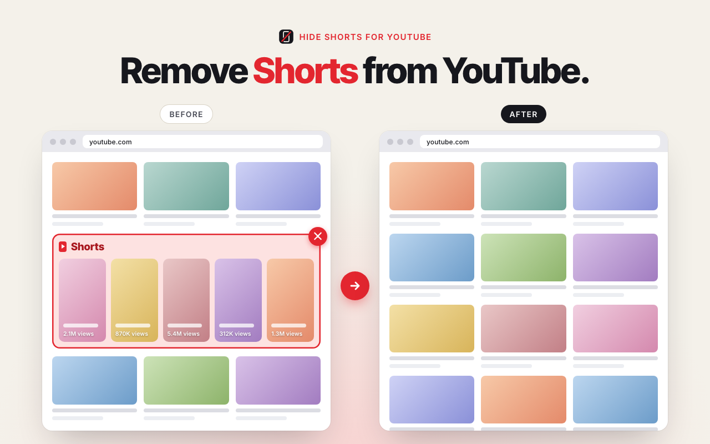

# Hide Shorts for YouTube

A Firefox extension that removes Shorts from YouTube:

- the Shorts entry in the left sidebar and the mini guide
- Shorts shelves on Home, Subscriptions, Search and recommendations
- individual Shorts videos in lists and grids
- the Shorts tab on channel pages and the Shorts filter on the search page
- `/shorts/VIDEOID` links open in the regular player (`/watch?v=VIDEOID`)

Works on both www.youtube.com and m.youtube.com. Requires Firefox 142 or newer.
The extension collects no data and needs no extra permissions.

## Install

Install it from [Firefox Add-ons](https://addons.mozilla.org/firefox/addon/hide-shorts-for-youtube/).

## Run from source

1. Open `about:debugging#/runtime/this-firefox` in Firefox
2. Click **Load Temporary Add-on…**
3. Pick `manifest.json` from this folder

A temporary add-on is removed when Firefox is closed.

## If some Shorts element stays visible

YouTube changes its page structure from time to time. The hidden elements are
listed in `hide-shorts.css`. Issues and pull requests with new selectors are welcome.

## License

[MIT](LICENSE). Not affiliated with or endorsed by YouTube or Google.
